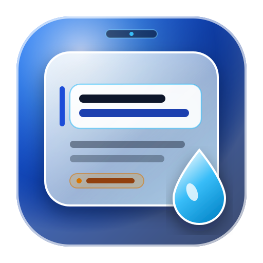

# CueGlass Studio (Pathfinder Glass)

<p align="center">
  
</p>

**CueGlass Studio** (*Pathfinder Glass*) is an open-source, near-camera macOS Liquid Glass teleprompter and live host overlay engineered for webinars, keynotes, Zoom/Teams moderation, and technical events. It places a compact, movable **macOS 26 Tahoe Clear Liquid Glass** reading window directly beneath your MacBook's built-in camera notch so your eye line stays naturally locked on the camera.

---

## ✨ Key Features

1. **Authentic Apple macOS 26 Tahoe Clear Liquid Glass & Classic Card UI**
   - **Full-Window Liquid Glass Mode:** Pure optical translucency with SVG displacement lens refraction, specular rim highlights, and zero harsh inner divider borders.
   - **1-Click Presets:** Switch effortlessly between **Apple Clear Glass** (`Glass.clear` Light) and **Tahoe Dark Glass** (`Glass.identity`, Liquidness `100%`, Transparency `10%`, Glass Effect `15%`, Active Beat Glow `21%`), or switch to **Classic Card UI** for a solid, zero-glass traditional layout.
   - **macOS Tahoe Glass Sliders:** Dragging any slider dynamically transforms its thumb into a translucent refractive glass capsule.

2. **Hands-Free Siri Dictation Voice Auto-Follow**
   - **Strictly Speech-Driven:** Tracks the exact words you speak in sequential order using lightweight built-in macOS Siri Dictation / Web Speech API—never scrolls on a timer during silence.
   - **Advanced Mispronunciation & Error Recovery:** Combines phonetic consonant-skeleton matching (`toPhoneticCode`), Damerau-Levenshtein fuzzy distance, compound-word split/merge tolerance, N-best speech alternatives, and a 5-word sequential lookahead window so skipped or mispronounced words never stall the teleprompter.
   - **Lightweight 3-Beat Sliding Window:** Tracks only the **Previous**, **Current**, and **Next** lines with zero persistent word-position memory overhead, automatically advancing to the next beat when you finish speaking the active line.
   - **Customizable Spoken Word Darkening:** Choose whether spoken words progressively dim as you read (**Darken Spoken Words** with adjustable opacity `15%–75%`) or stay at 100% brightness (**Stop Word Darkening — Clean View**) while still auto-advancing hands-free.

3. **Fluid Corner-Morph Collapse & Near-Camera Ergonomics**
   - **Near-Camera Snap (`⌃⌥H`):** Snaps the floating window centered just below the MacBook camera notch, keeping the active beat in the upper 22% of the viewport.
   - **Liquid Corner Morph (`⌃⌥P`):** Smoothly collapses the window into a 46 pt draggable Liquid Glass progress dot anchored to the top-right corner and expands back without losing your place.
   - **Responsive Compact Chrome:** Icon-first top bar and responsive bottom bar designed to scale cleanly down to 360 px width without overflow.

4. **Deterministic Markdown Script Engine & 1-Click AI Script Generator**
   - Parses `#` metadata, `## 00`–`## 12` sections, `###` subsections, spoken beats, 6 distinct stage/production cue categories (`*[...]*`), `==highlights==`, `[PAUSE]`/`[BREATHE]` cadence pills, and `[Placeholder]` preflight checks.
   - Includes a built-in **AI Prompt & Syntax Guide** (`✨` button) to generate formatted teleprompter scripts in 1 click with Gemini, Claude, or ChatGPT, plus a live Markdown editor with 5 rolling local backups.

---

## 🎨 App Icon Architecture

The official app icon is a **macOS 26 Tahoe Liquid Glass Squircle** featuring a deep Sapphire-to-Cyan refractive backdrop, a floating frosted teleprompter card with an active beat focus bar, and a refractive glass droplet emblem:
- **Vector Master Asset:** [`public/cueglass-icon.svg`](public/cueglass-icon.svg)
- **Native macOS `.icns` Bundle Icon:** Automatically rendered at all 10 Retina resolutions (`16×16` through `1024×1024` / `512×512@2x`) via CoreGraphics and compiled with `/usr/bin/iconutil` into `Contents/Resources/AppIcon.icns` inside `build-release.sh`.

---

## 🚀 Building & Packaging the Final Product (With Embedded App Icon)

You can build and share CueGlass Studio either as a **Native macOS `.app` & `.dmg` Installer** (Swift 6 + AppKit/SwiftUI) or as a **Web / Cross-Platform Studio Build** (React 19 + TypeScript + Vite).

### Option A: One-Click Native macOS `.app` & Shareable `.dmg` (Recommended for Mac)

#### Requirements
- Apple Silicon (`arm64`) or Intel Mac running **macOS 15 Sequoia** or **macOS 26 Tahoe**
- **Xcode 16+** or **Xcode Command Line Tools** (`xcode-select --install`)

#### Method 1 — Double-Click in Finder
1. Clone or download this repository to your Mac.
2. Double-click **`Build-and-Export-DMG.command`** in Finder (or download **`Build-Pathfinder-Glass-DMG.command`** directly from the app's Xcode/DMG modal).
3. The script automatically:
   - Runs the native unit test suite (`swift test`)
   - Compiles the Release binary (`swift build -c release`)
   - Generates the 1024×1024 Retina **`AppIcon.icns`** and embeds it into `dist/Pathfinder Glass.app/Contents/Resources/AppIcon.icns`
   - Bundles `Resources/Pathfinder26.md` and `Info.plist` (including `CFBundleIconFile` and Microphone/Speech Recognition permissions)
   - Ad-hoc signs the `.app` bundle and packages **`dist/Pathfinder-Glass.dmg`** with an `/Applications` drop-link.

#### Method 2 — Terminal Commands
```bash
git clone https://github.com/<your-username>/cueglass-studio.git
cd cueglass-studio

# Make build scripts executable
chmod +x build-release.sh package-dmg.sh Build-and-Export-DMG.command

# Build 'dist/Pathfinder Glass.app' (with AppIcon.icns) and 'dist/Pathfinder-Glass.dmg'
./package-dmg.sh
```

#### Sharing the `.dmg` with Friends (Gatekeeper Note)
Because local builds use free ad-hoc code signing (`codesign --sign -`) without a paid $99/yr Apple Developer ID notarization certificate, friends opening your shared `Pathfinder-Glass.dmg` on another Mac should:
1. Open **`Pathfinder-Glass.dmg`** and drag **Pathfinder Glass.app** to **Applications**.
2. Right-click **Pathfinder Glass.app** in `/Applications` and click **Open**, or run this one-liner in Terminal to clear the download quarantine flag:
   ```bash
   xattr -dr com.apple.quarantine "/Applications/Pathfinder Glass.app"
   ```

---

### Option B: Web & Cross-Platform Studio Build (React + TypeScript + Vite)

#### Requirements
- **Node.js 20+** and `npm` (or `bun`)

#### Development, Testing & Production Build
```bash
# 1. Install dependencies
npm install

# 2. Run unit tests (Parser, Navigation, Geometry, Store, and Voice Auto-Follow)
npx tsx --test src/core/pathfinder.test.ts

# 3. Start local development server on http://localhost:3000
npm run dev

# 4. Type-check and build production static bundle into dist/
npm run lint
npm run build
```

The production web bundle in `dist/` includes `cueglass-icon.svg` as its favicon/app icon and can be deployed directly to **GitHub Pages**, **Vercel**, **Netlify**, or Cloudflare Pages.

---

## 🎙️ Using Voice Auto-Follow & Word Darkening Settings

1. Click **`▶ Voice Follow`** in the bottom bar of the floating teleprompter window.
2. Speak your script naturally:
   - The 3-beat engine tracks your exact spoken words in sequential order within the active beat.
   - If a word is mispronounced or slurred by dictation, phonetic skeleton matching and 5-word lookahead automatically recover as soon as you speak the next words.
   - Reaching the end of the current beat automatically advances and smoothly scrolls to the next beat.
3. **Customizing or Turning Off Word Darkening:**
   - Click the **Settings Gear (`⚙`)** in the top bar (or open **All Cap Settings & Shortcuts**).
   - Under **Auto Voice Follow & Spoken Word Darkening**, choose between:
     - **Darken Spoken Words:** Dims words you have already spoken (with a slider to adjust dimmed opacity between `15%` and `75%` and an optional target-word underline).
     - **Stop Word Darkening (Clean View):** Keeps all words at 100% crisp brightness without darkening while still listening and automatically switching lines when you finish speaking.

---

## ⌨️ Keyboard Shortcuts

### When Floating Script Panel is Focused
| Shortcut | Action |
| :--- | :--- |
| `→` or `Space` | Next spoken beat (auto-advances across sections 00–09) |
| `←` or `Shift + Space` | Previous spoken beat |
| `↓` / `↑` | Next / Previous main section (00–09) |
| `T` | Jump directly to `THANKING THE SPEAKER` waypoint (Sections 04–07) |
| `⌘+` / `⌘-` | Increase / decrease reading font size (18–48 px) |
| `⌘⇧T` | Toggle between Light and Dark Liquid Glass themes |
| `Esc` | Close open popover/modal or return from on-demand snippet to live position |

### Global Safe Chords (While Zoom or Slides Have Focus)
| Chord | Action |
| :--- | :--- |
| `⌃⌥→` / `⌃⌥←` | Next / Previous beat |
| `⌃⌥↓` / `⌃⌥↑` | Next / Previous main section |
| `⌃⌥P` or `⌃⌥M` | Collapse to 46 pt Liquid Glass Dot / Expand Reading Panel |
| `⌃⌥H` or `⌃⌥0` | Snap panel Near Camera (top-center below MacBook notch) |

---

## 📂 Repository Structure

```text
├── public/
│   ├── cueglass-icon.svg                         # Official Liquid Glass Squircle App Icon (SVG)
│   ├── Build-Pathfinder-Glass-DMG.command        # Self-contained 1-click macOS .command DMG builder
│   └── PathfinderGlass-macOS-Xcode-Source.tar.gz # Complete Native Xcode & SwiftPM source archive
├── src/
│   ├── App.tsx                                   # Main Liquid Glass Studio & Voice Auto-Follow controller
│   ├── index.css                                 # Apple macOS 26 Tahoe Liquid Glass & slider physics CSS
│   ├── components/                               # Modular UI modals, RichTextRenderer, & popovers
│   └── core/
│       ├── voiceTracker.ts                       # Sequential phonetic & fuzzy 3-beat Voice Follow engine
│       ├── parser.ts                             # Deterministic Markdown script parser
│       ├── navigation.ts                         # Beat/section state machine & remapping
│       ├── geometry.ts                           # Near-camera notch & viewport clamping math
│       ├── store.ts                              # Atomic local script persistence & 5 rolling revisions
│       └── pathfinder.test.ts                    # Node test suite (10 suites covering all core logic)
├── PathfinderGlass/                              # Native Swift 6 / SwiftUI / AppKit macOS source
├── PathfinderGlassTests/                         # Native XCTest unit test suites
├── Resources/Pathfinder26.md                     # Canonical default event script
├── build-release.sh                              # Native macOS .app builder + Retina AppIcon.icns generator
├── package-dmg.sh                                # Native macOS .dmg disk image packager
├── Build-and-Export-DMG.command                  # Finder double-click native build launcher
└── LICENSE                                       # MIT Open Source License
```

---

## 🤝 Contributing & License

Contributions, issues, and feature requests are welcome! Feel free to fork this repository, customize `Resources/Pathfinder26.md` or use the built-in **AI Script Generator Prompt** (`✨`) for your own events, and submit pull requests.

Released under the **[MIT License](LICENSE)**.
